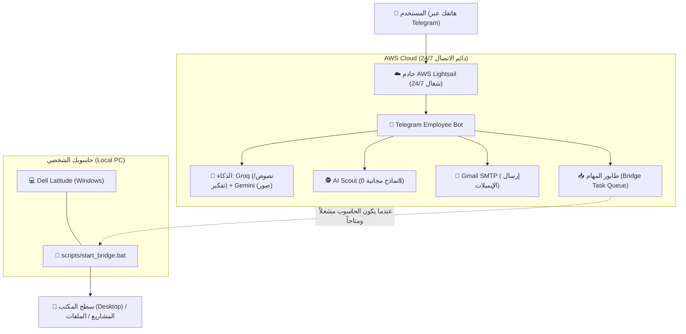

# 🚀 دليل رفع المشروع على AWS وتشغيل جسر الحاسوب 24/7 (AWS Cloud & PC Bridge Guide)

هذا الدليل يشرح بالتفصيل كيف تجعل موظفك الآلي (@L3abd3lall9adossbot) يعمل سحابياً على مدار الساعة **24/7**، حتى لو كان حاسوبك الشخصي **مطفأ بالكامل (Turned Off)** أو بدون إنترنت، مستفيداً من رصيد الـ **$100 مجاناً** في حسابك على AWS!

---

## 🏗️ 1. كيف يعمل النظام (المعمارية الذكية)



### السيناريوهات:
1. **عندما يكون حاسوبك مطفأ (PC is OFF):**
   - البوت يجيبك فوراً على تيليجرام 24/7: حل المسائل، البرمجة، البحث في الويب، استكشاف نماذج AI المجانية، وإرسال الإيميلات.
   - إذا طلبت مشروعاً أو ملفاً محلياً، يقوم البوت بحفظ الطلب في **طابور المهام السحابي**.
2. **عندما تقوم بتشغيل حاسوبك (PC turns ON):**
   - يتصل الجسر `start_bridge.bat` فوراً بخادم AWS، ويستلم أي مهام معلقة، وينفذها على سطح المكتب، ويرسل لك إشعاراً في تيليجرام: `⚡ حاسوبك متصل الآن! تم إنشاء مشروعك على سطح المكتب بنجاح.`

---

## 💰 2. استغلال رصيد 100$ في AWS (شغال لأكثر من سنة ونصف مجاناً)

خطة **AWS Lightsail** بتكلفة **$3.50 إلى $5.00 في الشهر**:
- رصيدك $100 سيكفي لتشغيل السيرفر بدون توقف لمدة **20 إلى 28 شهراً** دون دفع أي سنت من جيبك!

---

## 🛠️ 3. خطوات إنشاء السيرفر في AWS Lightsail (5 دقائق)

1. سجل الدخول إلى [AWS Lightsail Console](https://lightsail.aws.amazon.com/).
2. اضغط على **Create instance**.
3. اختر:
   - **Platform:** Linux/Unix
   - **Blueprint:** **OS Only** -> اختر **Ubuntu 24.04 LTS** (أو 22.04 LTS).
   - **Instance Plan:** اختر خطة **$3.50/mo** أو **$5.00/mo** (512MB أو 1GB RAM).
   - **Instance Name:** سمّه مثلاً `dspy-employee`.
4. اضغط على **Create instance**.
5. انتظر دقيقة حتى تصبح الحالة `Running`، ثم اضغط على أيقونة التيرمنال البرتقالية `>_` للاتصال بالسيرفر مباشرة عبر المتصفح (SSH).

---

## ⚡ 4. الأوامر لتشغيل المشروع على السيرفر

داخل شاشة التيرمنال في المتصفح، قم بتنفيذ ما يلي:

### الخطوة أ: استنساخ المشروع
```bash
git clone <رابط_مستودعك_على_GitHub> dspy-multi-agents
cd dspy-multi-agents
```
*(أو يمكنك رفع ملفات المشروع عبر SCP/SFTP إلى `/home/ubuntu/dspy-multi-agents`)*

### الخطوة ب: إعداد ملف المتغيرات (.env)
```bash
nano .env
```
انسخ والصق محتويات ملف `.env` الخاص بك (مفاتيح GROQ, GEMINI, TELEGRAM_BOT_TOKEN)، ثم احفظ بالضغط على `Ctrl+O` ثم `Enter`، ثم اخرج بـ `Ctrl+X`.

### الخطوة ج: تشغيل التثبيت التلقائي
```bash
chmod +x aws_deploy/setup_lightsail.sh
./aws_deploy/setup_lightsail.sh
```

**مبروك! 🎉 البوت الآن شغال 24/7 ولن يتوقف أبداً حتى لو أغلقت المتصفح أو أطفأت حاسوبك.**

---

## 🌉 5. تشغيل جسر الحاسوب التلقائي (Local Bridge)

على حاسوبك (Windows):
1. داخل مجلد المشروع، ستجد ملفاً باسم:
   `c:\dspy-multi-agents\scripts\start_bridge.bat`
2. افتح ملف `.env` على حاسوبك وأضف رابط سيرفر AWS الخاص بك:
   ```env
   AWS_SERVER_URL=http://<IP_الخاص_بسيرفر_AWS>
   ```
3. انقر مرتين على `start_bridge.bat` لتشغيله.

> [!TIP]
> **التشغيل التلقائي عند فتح الحاسوب (Autostart):**
> اضغط `Win + R` واكتب `shell:startup`، ثم ضع اختصاراً (Shortcut) لملف `start_bridge.bat` في ذلك المجلد.
> بهذه الطريقة، في كل مرة تشغل فيها حاسوبك المحمول، سيتصل تلقائياً مع خادم AWS دون أي تدخل منك!

---

## 📱 6. تجربة الأوامر من هاتفك الآن:
- اكتب `/bridge` لمعرفة ما إذا كان حاسوبك متصلاً أم مغلقاً.
- اكتب `/scout` أو *"جيب لي نماذج AI مجانية"* لاستكشاف أحدث النماذج المجانية مع الروابط.
- اكتب `/create ecommerce_store` وسيقوم إما بإنشائه فوراً أو وضعه في الطابور إذا كان حاسوبك مغلقاً!
