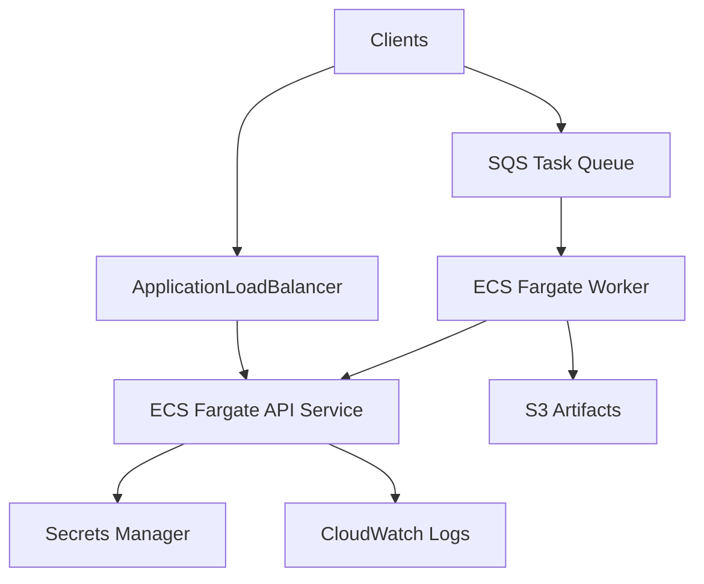

# AWS deployment recommendation (documentation only)

Deploy only after local end-to-end tests pass and you explicitly approve cloud spend.

## Target architecture

## Components

| Service | Role |
|---------|------|
| **ECS Fargate** | Run API container from [Dockerfile](../Dockerfile); separate worker service for long jobs |
| **Application Load Balancer** | HTTPS termination, health checks on `/health` |
| **Amazon SQS** | Async jobs (replace `sqs_worker.py` stub); dead-letter queue for failures |
| **Amazon S3** | Store research artifacts, exports, uploaded files |
| **AWS Secrets Manager** | `OPENCODE_ZEN_API_KEY` injected into task definitions |
| **CloudWatch** | Logs, metrics, alarms (5xx rate, queue depth, task duration) |
| **RDS / DynamoDB** | Add only when task history and user data require persistence |

## Deployment steps (high level)

1. Build and push image to **ECR**.
2. Create ECS cluster, task definitions (API + worker), and Fargate services.
3. Store Zen API key in Secrets Manager; reference in task `secrets`.
4. Create SQS queue + DLQ; worker polls and calls internal API or shared agent library.
5. Configure ALB target group → API service; restrict security groups (least privilege).
6. Set auto-scaling on CPU and SQS approximate age of oldest message.

## IAM (least privilege)

- **API task role:** `secretsmanager:GetSecretValue` for Zen secret; `sqs:SendMessage` if enqueueing.
- **Worker task role:** `sqs:ReceiveMessage`, `sqs:DeleteMessage`, `s3:PutObject` on artifact bucket.
- No broad `*` on S3 or Secrets Manager.

## Scaling

- **API:** Scale on CPU/request count; keep stateless.
- **Workers:** Scale on SQS queue depth.
- **LLM:** Dominant cost is Zen/OpenCode usage, not Fargate.

## Cost drivers

1. **LLM requests** (Big Pickle / Zen billing)
2. **Fargate** vCPU-hours (API + workers)
3. **NAT Gateway** (if tasks in private subnets without VPC endpoints)
4. **CloudWatch** log ingestion
5. **S3** storage and egress

Skip RDS until persistence is required to avoid fixed database cost on an MVP.

## Pre-production checklist

- [ ] API key only in Secrets Manager
- [ ] `check_llm=1` health check in staging with funded Zen account
- [ ] Request timeouts aligned with `TASK_TIMEOUT_SECONDS`
- [ ] WAF or API key on public ALB
- [ ] No host code execution without isolated sandbox (Lambda/Fargate sandbox)

No resources in this document are provisioned automatically.
